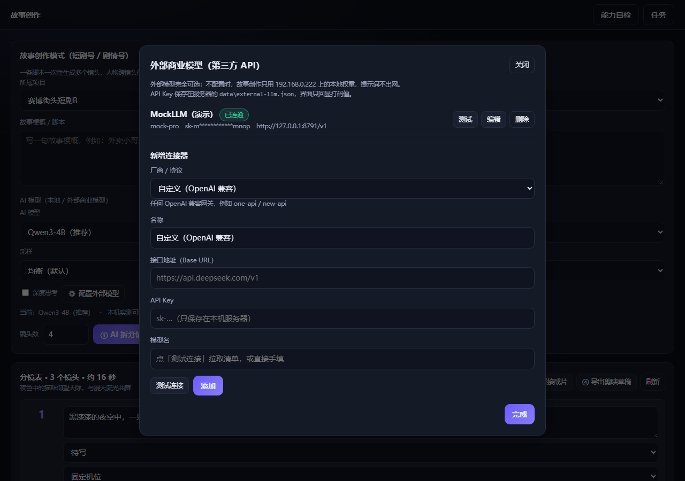

# AI 短视频创作台（本地 ComfyUI 版）

参考万相 / 即梦 / 可灵的产品形态，把**本机 ComfyUI（192.168.0.222:8188）**上的本地模型封装成一套
可直接用的 Web 创作台：文生图、图生图、图生视频、参考生视频、原生最长 20 秒音画同步、
多镜头故事创作、素材无水印导出、剪映草稿一键打通。

配套需求报告：`../workspace/comfyui-report/AI短视频创作平台-需求报告.md`

有一个例外：**「AI 翻唱」整条链路跑在跑本服务的这台机器（192.168.0.128）上** ——
222 只放了图像与视频模型，没有翻唱 / 音色转换 / 歌声合成的权重（详见「AI 翻唱」一节）。

## 快速开始

```bash
npm install          # 只有 express / ws 两个依赖
npm start            # 默认 http://0.0.0.0:8899
```

打开页面后点右上角「能力自检」，即可看到本机当前可用的能力清单（缺权重的会自动置灰）。

```bash
npm run selftest                 # 静态自检：37 个工作流逐字段核对实机 /object_info
node tools/selftest.js --run WF-01A   # 端到端真跑一个工作流
```

## 技术形态

- **后端**：Node.js 22+ / Express 4 / `ws`；数据库用内置 `node:sqlite`（`DatabaseSync`），零原生编译依赖。
- **前端**：原生 ES Module + 手写 CSS，无构建步骤，改完刷新即生效。
- **生成侧**：所有模型都在本机 ComfyUI 上跑，Web 服务只做编排、素材管理、产物落盘与转发。
  前端只连本服务的 WebSocket（`/api/ws`），不直连 8188。

## 目录

| 路径 | 说明 |
| --- | --- |
| `server.js` | 启动入口：风格入库 → 连接池 → 任务编排 → Express + WS |
| `config.json` | 实例地址、存储路径、比例表、导出参数、认证开关 |
| `src/workflows.*.js` | 37 个 ComfyUI 工作流（图像 / 视频 / 音频 / 文本 / 翻唱 / 音乐），全部对齐实机模型名 |
| `src/workflows.registry.js` | 工作流注册表 + 能力自检（装配校验 + 实机字段核对） |
| `src/jobs.js` | 任务状态机、队列泵、WS 事件归一、OOM 降级、产物落盘 |
| `src/storyboard.js` | 多镜头故事模式 DAG（首帧图 → 视频，逐镜头串行） |
| `src/capcut.js` `src/zip.js` | 剪映草稿包 / 素材包（零依赖 ZIP） |
| `public/` | 前端：`index.html` + `css/app.css` + `js/{app,views,ui,api,trends}.js`（`trends.js` = 爆款复刻赛道清单） |
| `deploy/` | systemd 单元、启停脚本、nginx 反代示例 |
| `data/` | 运行时数据：SQLite、上传、产物、日志、剪映草稿 |

## 页面与能力

| 页面 | 能力 |
| --- | --- |
| 工作台 | 环境概览、能力可用性、项目列表、快捷入口 |
| 创作台 | 6 类模式（文生图/图生图/图生视频/文生视频/参考生视频/音频成片）× 多引擎，比例、时长、风格、角色锁、参考素材；**「智能扩写」跟着当前模式自动换写法**（8 种，见「提示词扩写」一节）；**新增「项目名称」：可下拉选已有项目、也可直接打一个新名字，重名实时校验，产物按项目名落盘（见「产物命名与项目名称」）** |
| AI 音乐 | **四条生成链路 + 一条后期链路，跑在本机 192.168.0.128 的 ComfyUI 上**：文生歌曲（MiniMax Music 3，歌词留空即纯音乐）、歌词成曲（YuE2）、锁旋律改编（YuE2 + SheetSage2，参考音乐可上传或从素材库选，**选视频会自动抽音轨**）、文生歌曲快版（ACE-Step 1.5）；「AI 写词 / 写风格」由本地 LLM 代笔；**音乐后期**在本机用 ffmpeg 做裁剪 / 接长 / 变速 / 拼接 / 响度归一（-14 LUFS），不占显卡 |
| AI 翻唱 | **三条链路，跑在本机 192.168.0.128 的 ComfyUI 上**：换音色翻唱（RVC）、整首重唱（ACE-Step 1.5）、人声 / 伴奏分离（Demucs）。选歌可上传或从素材库挑（**选视频会自动抽音轨**）→ 选玩法与参数（可让 AI 写词）→ 出片可试听 / 下载，产物直接进素材库 |
| 爆款复刻 | **25 个抖音 / 快手热门赛道**（剧情短剧 / 灵幻志怪 / 动画治愈 / 口播知识 / 带货种草 / 国潮美学 / 音乐情绪），点卡片自动套用整条预设（选题模板 + 分镜节拍 + 画幅 + 镜头数 + 风格模板 + 首帧出图引擎 + 视频引擎 + 是否带人声），一键「拆分镜 → 批量出片」，出片后接「故事创作」的拼接成片 / 烧字幕 / 剪映导出 |
| 配音 | 上传视频或从素材库选一段 → 自己写台词 → 本机语音合成 → **本机 ffmpeg** 合轨 → 带配音的无水印 MP4（可选压低保留原声）；**新入口「视频 + 音频合成」：视频从素材库挑或本地上传、音频本地上传，直接合出成片**；**再新增「歌词 → 字幕」：歌词粘贴或上传 → 与音频 / 视频自动对齐 → 导出 .lrc / .srt / .ass 三份标准字幕，可一键烧成硬字幕视频** |
| 故事创作 | 一句梗概 → AI 拆分镜表（可选本地/外部 LLM）→ **选风格模板 + 锁角色**（整条片子统一画风与长相）→ **选视频引擎**（默认 MiniMax-H3）→ 逐镜头生成（**默认「带声音」+「镜头带字幕」：台词走本机配音念，再烧成硬字幕**）→ **拼接成片（自选片段 / 排顺序 / 自动烧字幕，已带字幕的片段自动跳过）** → 导出剪映；**新增「项目名称」（重名实时校验，产物按项目名落盘）** |
| 角色卡 | **用本机文生图「生成立绘」**出形象图 + 角色参考图池（≤20 张，**缩略图 / 点开看大图 / 设为封面 / 左右排序 / 一键清理失效图**）+ 提示词锁，一键「用于创作台 / 用于故事创作」 |
| 模板广场 | 34 个内置风格模板（每张卡可「用于创作台」或「用于故事创作」）+ 578 个官方模板快照（标注本机是否可复现） |
| 素材库 | 按类型筛选、**卡片预览（图片放大 / 视频播放 / 音频试听）**、多选（单张勾选 / **一键全选**）、**批量删除选中（连带清掉磁盘文件）**、**拼接成片（可上传片段 · 可排顺序 · 可烧字幕）**、剪映草稿导出 |
| 任务中心 | 3 秒轮询、进度条、取消、产物预览、参数与事件日志 |

## 本机能力现状

| 能力 | 引擎 |
| --- | --- |
| 文生图 | Z-Image Turbo、Qwen-Image、NetaYume v3.5 |
| 图生图 / 重绘 / 扩图 / 放大 | Qwen-Image-Edit-2511、Z-Image Fun ControlNet、Outpaint、4xRealWebPhoto |
| 图生视频 / 文生视频 | Wan 2.2 I2V/T2V（含 LightX2V 加速 LoRA）、MiniMax-H3 T2V(t2va)、Wan 2.2 Animate、S2V 口型 |
| 运镜 / 首尾帧 / 续长 | Wan 2.2 Fun Camera、FLF2V、VACE ref2v / v2v、视频拼接 |
| 原生 20 秒 + 音画同步 | MiniMax-H3（`t2va` 文生 / `fl2va` 图生 / `ref2va` 参考生，24fps，480 帧 = 20 秒，均原生带音轨） |
| 长镜头音画同生 | LTX-2.5（22B 蒸馏 + Gemma 文本编码器） |
| 提示词 / 文案 / 剧本 | 本地 LLM 可切换（默认 Qwen3-4B，`TextGenerate`） |
| 配音 / 口播 / 旁白 | 本机 edge-tts（免费·无需 Key·不出网）或任意 OpenAI 兼容语音服务 → `WF-26` **在本机**用 ffmpeg 合轨（视频流直拷、不占显存） |
| 口型驱动 | Wan 2.2 S2V（`WF-09`，自带配音音频即可对着人物图开口）|
| 翻唱 / 音色转换 / 人声分离 | **本机 192.168.0.128**：RVC（`WF-28`）、ACE-Step 1.5（`WF-29`）、Demucs（`WF-30`） |
| AI 创作音乐 | **本机 192.168.0.128**：文生歌曲 MiniMax Music 3（`WF-18` / `WF-31`）、歌词成曲 YuE2（`WF-32`）、锁旋律改编 YuE2 + SheetSage2（`WF-33`）、文生歌曲 ACE-Step 1.5（`WF-34`）、音乐后期 ffmpeg（`WF-35`） |


当前自检结果 **36/37 可用**，只剩一项因权重缺失自动置灰（不需要改代码，把权重放好即可点亮）：

- `WF-23` 帧插值：`models/frame_interpolation` 目录为空

> `WF-18`（AI 生成 BGM）以前也被标成「缺 MiniMax Music 3 权重」——**那个结论是错的**：
> 权重一直在盘上，是那条老图用 `UNETLoader` / `CLIPLoader` / `VAELoader` 分体加载，
> 而这三个节点的下拉里根本没有这两个权重。现在已改用官方一体化节点，见「AI 创作音乐」一节。

此外 ComfyUI 本身**没有本地 TTS 节点**（`ElevenLabs / FishAudio / HeyGen / ByteDanceSeedAudio` 这类全是必须 API Key 的云端伙伴节点，
`custom_nodes/` 是空的）。所以「文字转语音」这一步由**跑 Web 服务的这台机器**上的 Python + `edge-tts` 完成：
免费、不需要 Key、中文音色齐全，合成的音频再上传到 222，用原生节点挂到画面上。
222 的 `models/` 里其实已经放好了 `iic/CosyVoice2-0.5B` 权重（见 `extra_model_paths.yaml` 的 `cosyvoice2` 段），
把它用 OpenAI 兼容壳跑起来、填进「⚙️ 语音服务」即可切成**完全本地**的引擎，代码不用改。

数字人口播既可自己上传配音，也可以直接用「配音」页合成的音频，再交给 `WF-09` 驱动口型。

### 多卡并行（4 张 A6000）

ComfyUI 单个进程只吃一张卡，所以 222 上按「一卡一实例」部署了 4 个 ComfyUI：

| 端口 | 显卡 | systemd 服务 |
| --- | --- | --- |
| 8188 | cuda:0 | `comfyui.service` |
| 8189 | cuda:1 | `comfyui-gpu1.service` |
| 8190 | cuda:2 | `comfyui-gpu2.service` |
| 8191 | cuda:3 | `comfyui-gpu3.service` |

本平台把这 4 个地址都填进 `config.json → comfy.instances`，调度器按「空槽位 + 空闲显存」自动分发：

- 队列泵会**同时填满所有空槽位**，也就是 4 个任务真正并行跑在 4 张卡上；
- 单个实例满载（`maxConcurrent`）时会被跳过，任务自动铺到其它卡，不会挤在一张卡上排队；
- 故事创作的「一键生成全部镜头」按当前空闲卡数决定并发度（4 卡 = 4 个镜头同时做）。
- 故事创作页的「视频引擎」下拉只列**能接首帧图**的引擎（WF-07 / WF-10 / WF-11 / WF-15 / WF-17），
  默认 **WF-15 MiniMax-H3 I2V**：画面和声音一次生成，出来的镜头自带台词 / 环境音 / 配乐，不用再单独配音。
  选完会存进项目（`project.meta.video_workflow`），下次进来自动带出来。
  口型驱动（WF-09，还要额外音轨）、参考驱动 / 拼接这类不接首帧的能力不在下拉里，
  后端 `resolveVideoWf()` 也会挡掉并给出人话提示。

实测（2026-09-29，同时提交 4 个文生图）：4 个任务分别落在 GPU 0/1/2/3，峰值并行 4，全部成功。

在 222 上一键扩容或重建多卡实例：

```bash
bash /data/setup-comfyui-multigpu.sh      # 4 张卡 → 8188/8189/8190/8191
bash /data/setup-comfyui-multigpu.sh 3    # 只用前 3 张
```

脚本随项目提供：`deploy/setup-comfyui-multigpu.sh`。

### 显存用完就还：完成 / 取消 / 空闲自动回收

ComfyUI 是把模型常驻在显存里的，跑完视频如果不主动释放，4 张卡会一直被占着
（实测跑完两个图生视频后，每张卡只剩 1.7 / 19.2 / 8.7 / 16.5 GB 可用）。现在任务编排器会在三个时机自动还显存：

| 时机 | 行为 |
| --- | --- |
| 视频 / 音频任务跑完 | `comfy.quietFreeSeconds`（默认 20 秒）后检查一次，确认没人接着用就卸载模型 |
| 任务失败 / 用户取消 | 同上 |
| 长时间空闲（兜底） | 任何一张卡连续空闲超过 `comfy.idleFreeSeconds`（默认 300 秒）都会被回收 |

**不是「一跑完就卸」，而是「跑完 + 这张卡确实没人用」才卸**。判定条件（`src/jobs.js` → `instanceIsIdle()`）：

1. 这张卡上没有我们派的活（槽位、在飞的 prompt_id、库里 running 的任务记录都算）；
2. 没有待派发的任务 —— 队列泵每 1.5 秒派一次，队列里还有下一段时卸掉等于刚出图就又要重新加载；
3. 整机都安静了：一场分镜里 A 卡先跑完、B/C/D 还在跑时，A 卡的模型留着继续用；
4. ComfyUI 自己的原生队列也是空的（可能有别的客户端直接往 8188~8191 塞了活儿）。

所以**图片任务不会一跑完就卸**（调封面常要连着改几次提示词，卸了每次都得重新加载），
由「长时间空闲」兜底统一回收。配音 / 拼接 / 烧字幕是本机任务（`instance` 为空）、不占显卡，
不算「忙」，不会拖住释放。任务中心手动点「释放显存」不受这些限制，随时可用。

实测（2026-10-01，两个图生视频并行 + 一个 MiniMax 任务同时在跑）：全部跑完后约 21 秒，
4 张卡的可用显存从 1.7 / 19.2 / 8.7 / 16.5 GB 一起回到 **47.1 / 46.9 / 46.9 / 46.9 GB**（模型全部卸载），
而且每张卡只释放一次；两段视频之间还有镜头没跑完时**不会**卸载（模型保持热态，省掉重载）。

### 素材库：多选 / 全选 / 批量删除（连带清文件）

素材库左上角每张卡都有一个勾选框（点缩略图即可勾选/取消），右上角是操作区：

| 按钮 | 作用 |
| --- | --- |
| 全选 / 取消全选 | 勾选**当前筛选出来的这一批**（切到「图片」再全选，选的就是这批图片） |
| 删除选中（N） | 批量删除勾选的素材，弹窗二次确认，删完自动刷新 |
| 取消选择 | 清空勾选，不影响素材 |

删除**会连磁盘文件一起清掉**（`POST /api/assets/delete` → `removeAssets()`），三条约束写死在代码里：

1. 只删 `data` 目录以内的文件 —— 不在 data 下的（手工放进去的素材）一律留着；
2. 同一个文件还被别的素材记录引用时留着（上传按「内容哈希_原文件名」落盘，同名同内容的多条记录共用一个文件）；
3. 删文件失败只记日志、不让接口报错 —— 记录已经删了，这时报错反而让人以为没删成功。

删掉的只是素材记录与文件本身；如果某个素材正被分镜当作首帧 / 参考图，删掉后那条分镜需要重新生成首帧（弹窗里有提示）。

> 顺手修掉的老 bug：`URLSearchParams` 会把 `undefined` 拼成 `kind=undefined`，
> 后端拿它当普通字符串匹配 —— 表现是「点过「图片 / 视频」筛选后再点「全部」，素材库变成 0 个」。
> 现在 `api.js` 统一用 `qs()` 丢掉 undefined / null / 空串。
> 后端 `GET /api/assets` 也加了白名单兜底（`kind` 只认 image / video / audio / file / text，其余一律当没传）—— 两端各堵一次。

### 素材库：卡片预览（图片 / 视频 / 音频）

每张卡的按钮区是 **预览 / 下载 / 删除** —— 不用先下载到本地就能看内容：

| 素材类型 | 点「预览」看到什么 | 悬停提示 |
| --- | --- | --- |
| 图片 | 弹窗里放大看图，点画面本身在新标签页看原图 | 放大看图 |
| 视频 | 弹窗里直接播放（带控制条，自动开始） | 播放视频 |
| 音频 | 弹窗里试听（🎵 + 播放器，自动开始） | 试听音频 |
| text / file | 不弹窗，右下角提示「暂不支持预览，可以直接下载」 | —— |

弹窗底部一行信息：`第 N / M 个 · 类型 · 大小 · 宽×高 · 时长 · 视频带/无音轨 · 创建时间`；
「上一个 / 下一个」按**当前筛选出来的顺序**连着翻 —— 切到「图片」再预览，翻的就是那 65 张，挑素材不用反复关弹窗。

> 实现要点：翻页时整个预览舞台是**清空重建**的，音频 / 视频靠这个自动停下来；
> 不要改成只换 `src`，否则两段声音会叠在一起放。

### 角色卡：本机生成形象图，一键用到创作台 / 故事创作

角色卡不再只是"填提示词"——每张卡上多了三个动作：

| 按钮 | 做什么 |
| --- | --- |
| 🎨 生成立绘 | 用**本机文生图**（极速 Z-Image / 高质量 Qwen-Image / 二次元 NetaYume）给角色出形象图 |
| 用于创作台 | 勾上这个角色并跳到创作台，出图时自动把它当参考图带上 |
| 用于故事创作 | 勾上这个角色并跳到故事创作，整条片子的每个镜头都沿用同一张脸 |

生成立绘弹窗里可以选引擎、比例（默认 1:1 方形）、张数（1–4 张，多张会并发提交，交给 222 上的多卡并行池）、
再套一个风格模板；提示词默认就是「角色名 + 提示词锁」，可以直接改。生成结果自动进参考图池（上限 20 张），
第一张同时当封面。**「编辑角色卡」弹窗里也有同一个按钮**，新建角色时就能顺手把形象图生成好。

形象图存进 `ref_images` 之后，出片时由 `src/jobs.js` 读取：`refs.character` 会带上角色形象图
（默认最多 3 张，`params.max_ref_images` 可调），提示词里再拼上 `【角色】提示词锁` —— 跨镜头、跨视频都是同一个人。

**形象图被删掉也不会再把任务拖崩**：角色卡里存的参考图 id 可能已经被从素材库删除（用户清过素材库 / 换过形象图）。
出片时后端会**遍历整个参考图池、跳过失效 id**，能用的就传上去；一张可用的都没有时**照常出片**（只靠 `prompt_lock`
的文字描述锁长相），并在任务详情里写一条 `warn` 提醒你去补图。

- 「角色卡」和「故事创作」的角色芯片上会带 ⚠️ 小标；勾选了这种角色时页面会提示「参考图已不在素材库里」。
- 恢复办法：到「角色卡」对这张卡点 **🎨 生成立绘**（本机文生图，本地 Qwen3-4B 写提示词），生成好即写回参考图池，`PATCH` 保存时会自动剔除失效 id。
- `GET /api/characters` 每条角色现在带健康度字段 `refs_total / refs_missing / refs_live / stale_refs`，前端与排查都靠它。

### 角色卡参考图池：看得见、选得动、删得掉

「编辑角色卡」弹窗里的参考图池现在是一格格**真缩略图**（以前只画灰块 + 序号，看不出是哪张、也没法换）：

- 缩略图直接渲染素材原图，鼠标移上去出现三个小按钮：**设为封面**（封面决定 `ref_image`，也就是角色芯片上的圆头像）、**←**、**→** 调顺序。
- **点缩略图看大图**（复用素材库的预览弹窗，可左右翻）。
- **✕** 从池子里移除；**🧹 清理失效图**一次把所有「原素材已被删除」的 id 清干净，点「保存」写进角色卡。
- 池子里的 id 在素材索引里查不到时，会先 `ensureAssets()` 补拉一次完整清单再判断 —— 不会把好好的图误判成失效。
- 封面指向的图被删掉时**自动落到池子里第一张还能用的图**，不用手动改。
- 新建角色（`POST /api/characters`）也和后端 `PATCH` 一样会剔除失效 id，角色卡不会一建好就带死链。
- 创作台 / 故事创作 / 爆款复刻的角色芯片上多了一个 **✎**，点它直接进这张卡的参考图池。

### 故事创作：风格模板 + 角色锁定

故事创作页在「视频引擎」下面多了两个选择器，作用是**整条片子统一**：

| 选择器 | 作用 | 存到哪 |
| --- | --- | --- |
| 风格模板（整条片子统一画风） | 拆分镜时把风格写进剧本要求，出片时每个镜头都套上模板前缀 | `project.style_id` |
| 角色锁定（跨镜头保持长相，可多选） | 每个镜头的「首帧图 → 视频」都带上这些角色的形象图 | `project.meta.character_ids` |

- 两个都存进项目，**下次进来自动带出来**（只在切换项目时重新同步，不会覆盖你手选的结果）。
- 模板广场每张风格卡现在有两个按钮：「用于创作台」和「用于故事创作」，点后者直接带着这个风格跳到故事创作。
- 「① AI 拆分镜」「② 一键生成全部镜头」「单镜头生成」都会把这两个选择一起提交给后端。

### 故事创作：镜头数量按你填的来（拆不满会自动续写）

「① AI 拆分镜」的镜头数（输入框上限已从 12 放到 60）现在是**硬要求**，不再是「跟模型商量」：

- **预算按镜头数给**：`/api/script/generate` 用 `estTokens = 600 + 镜头数 × 280` 估输出长度
  （本机模型封顶 8192，外部模型封顶 32000）。以前不管拆几个都只给 2600，外部模型还会被
  `src/llm-external.js` 的 `MIN_MAX_TOKENS = 4096` 兜住 —— 36 个镜头的 JSON 约 5000 token，**必然写到一半被切断**。
- **切断不再等于「静默少一半」**：`chat()` 现在会看 `finish_reason`，正文非空但被 `length` 截断时
  自动把上限翻倍（≥8192，最多放大 4 次、顶格 32000）重试一次拿更长的正文；本机模型没有 `finish_reason`，
  用 `looksTruncated()` 数 `{}` / `[]` 是否配平来判断。两条链路都把 `truncated` 带回给调用方。
- **数量校验 + 缺口续写**：解析出的镜头数少于你要的，就带着「已经写到第几个、下一个该写谁」再要一次
  （最多 3 轮，按 `prompt` 去重防重复）；多于你要的就裁剪，`idx` 统一重排 —— **要 36 个就存 36 个**。
- **提示词跟着改**：镜头数量写进系统提示并声明「数量优先于总时长」；`SYS_STORYBOARD` 里那句
  「总时长尽量 20 秒以上」也改成「用户指定了镜头数量时以数量为准（正好写满）」。
- 生成后的提示直接用后端返回的 `note`：写满就是「已按你填的 36 个镜头拆分（单镜 5 秒）」；
  万一只写全了一部分，会变成警告色的「你要 36 个镜头，模型这次只写全了 N 个（输出被 token 上限截断）」，
  不会再出现「填 36 拿到 14 而且没人告诉你」。

> 完整根因（4096 是怎么来的、为什么 14:20 那次反而成功）见需求报告**附录 AJ**。

### 爆款复刻：单镜时长 + 提示词扩写

- **单镜时长**：「复刻设置」里和「镜头数」并排的**单镜时长**（2~20 秒，默认取该赛道的推荐值，
  25 个赛道目前都是 5 秒）会随请求一起发给 `POST /api/script/generate` 的 `duration_s`：
  服务端把它写进给大模型的指令（`单镜时长：每个镜头的 duration_s 都写成 X`），
  并在 `src/prompt.js` 的 `normalizeShots(parsed, { duration_s })` 里**强制覆盖**模型自己写的秒数 ——
  一条片子每镜等长，拼接后的节奏才稳。切换赛道会回到该赛道的推荐时长（`t.duration`）。
- **提示词扩写**：梗概输入框右上角「✨ 提示词扩写」打开与创作台共用的扩写弹窗，
  默认模式是「剧本分镜拆解」，跑完把结果**写回「故事梗概」**：优先用
  `logline + 每个镜头的画面（带台词）` 拼成一段能直接再拆分镜的脚本。
- 为了共用，`openEnhance(ctx, opts)` 有 5 个可选参数：`initial`（预填文本）、`mode`（固定预选模式，故事创作 / 爆款复刻用 `storyboard`）、
  `auto`（**跟着创作台当前模式自动匹配写法**，创作台用这个）、`title`（弹窗标题）、`onApply(result, raw)`（回填逻辑，传了就不再默认回填到创作台提示词）。
- 小模型会把 `storyboard` 的 JSON 写崩（键名带空格）或被 `max_length` 截断，
  这时 `enhanceToScript()` 会从原文里正则抠出 `logline` 与所有 `prompt` 字段兜底；
  连字段都抠不出来就**保持原梗概不动**并提示换模型，绝不把半截 JSON 覆盖进去。

### 提示词扩写：8 种方式，跟着创作台当前模式自动切换

以前扩写弹窗只有「图像提示词扩写 / 抖音爆款文案 / 剧本分镜拆解」三种，跟创作台选的类型没关系。
现在扩写方式与 `MODES` 一一对应，**打开弹窗时默认就是当前模式该用的那一种**：

| 创作台模式 | 扩写方式（`mode`） | 回填到创作台的东西 |
| --- | --- | --- |
| 文生图 | `image_prompt` | 提示词 + 负向词 + 风格词个数 |
| 图生图 | `image_edit` | 提示词 + 负向词 + 改图幅度建议（`edit_strength`）+ 要保留的特征（`keep`） |
| 图生视频 | `video_i2v` | 提示词 + 运镜 + 时长 + 音效提示 |
| 文生视频 | `video_t2v` | 提示词 + 运镜 + 时长 + 分好的段数 |
| 参考生视频 | `video_ref` | 提示词 + 运镜 + 时长 |
| 音频 / 成片 | `audio_final` | 逐句配音文案写进「视频配音」页的台词框 + 混音 / 环境音 / 字幕条数提示 |
| 任意模式（额外选项） | `viral_copy` | 标题 / 钩子 / 话题 / 口播稿 |
| 任意模式（额外选项） | `storyboard` | 剧本分镜（故事创作、爆款复刻默认走这个，会写回梗概框） |

- 在弹窗里手动改过的写法会**按创作台模式分别记住**（`state.enhanceModes`），切回该模式仍是上次那种。
- 服务端 `WF-24.supports.modes` 由 `SYSTEM_PROMPTS` 的键推导，`GET /api/system/capabilities` 里能看到这 8 项。
- 本地小模型写 JSON 常见的两种笔误（收尾的 `}` 打成 `)`、被 `max_length` 截断少几个闭合符），
  现在由 `src/prompt.js` 的 `repairJson()` 先修一遍再交给 `extractJson()` —— `audio_final` 这种长结构不再整条解析失败。

### 成片拼接：自己挑片段、自己排顺序（本机执行）

故事创作页的「③ 拼接成片（排顺序 / 烧字幕）」和素材库的「拼接成片」都会弹出**同一张片段清单**：
默认按分镜顺序把**每个镜头最新出的那条视频**排好，可以 `↑` `↓` 调顺序、`✕` 移除、
从素材库补片段、直接上传本地视频，还能选一条 BGM、勾「拼接后自动烧字幕」。
**清单里的顺序就是成片顺序。**

拼接在**本机用 ffmpeg 完成**（`src/concat.js`，工作流清单里登记为 `WF-16L`）：

- **不再把成片上传回 222**：原先走 ComfyUI 的 `ConcatenateVideo`（WF-16）必须先把每一段
  上传回去，片段一大就撞 ComfyUI 的**单请求 100MB 上限**
  （`HTTP 413 Maximum request body size 104857600 exceeded`，实测 17 段成片必然失败，
  另一条是 `fetch failed`）；拼接本身是纯 I/O、不吃显存，放本机秒级完成。
  `WF-16` 仍保留，接口传 `engine: "comfy"` 时走它。
- **规格自动归一化**：Wan 系列是 **720×1280 @16fps 无音轨**，MiniMax-H3 / LTX-2.5 是
  **736×1280 @24fps 带音轨**，直接拼会失败
  （`Accumulated videos have incompatible frame dimensions: chunk 0 is 720x1280; chunk 21 is 736x1280`）。
  现在以**多数票**选出目标尺寸与帧率：规格一致的片段**直接流拷贝、不重新编码**，
  只有异形片段才 `scale + pad` 到目标尺寸并按时间轴**等比抽帧**
  （只改 `-r` 会让那一段变成慢动作）。
- **音轨**：只要有一段带声音，就给没声音的段落补一条**等长静音轨**（"全有或全无"）；
  全都没声音就统一去掉音轨。
- **原声对齐（修「一条片子里有好几种混音」）**：带声音出片时，**有台词**的镜头是
  「模型原声压到 `-14dB` + TTS 人声 `0dB`」，**没台词**的镜头以前原样不动、还是满档原声又没有人声 ——
  两种混着拼起来，听感就是音量忽大忽小。现在拼接前会把所有**没人声的片段**的原声统一压到与配音
  镜头同一档（`src/mux.js` 的 `regain()`，产物落一条 `*_lvl.mp4`），成片里所有段的原声都在同一档；
  弹窗里的「④ 混音 · 统一原声音量」默认勾选，`POST /api/export/final` 传 `level_audio: false` 可关掉。
- **根因也在出片阶段修了**：故事创作 / 爆款复刻勾「带声音」时，**没台词的镜头会当场做一次原声对齐**
  （`src/storyboard.js`，工作流仍记 `WF-26`，任务标题「镜头原声对齐（无台词）」），
  所以新出的素材天生就是同一档，拼接时的对齐只是给历史素材 / 素材库里混着挑的片段兜底。
- **无声引擎（Wan 2.2 等）不参与原声对齐**：这类引擎的产物**根本没有音轨**，没有原声可压，
  而且「全程无声」本身就是一致的、不存在几种混音。所以出片前会先探测素材到底有没有音轨
  （`mux.hasAudioTrack()` 按 MP4 的 `soun` handler 判定），没有就**跳过、连任务都不建**；
  `mux.regain()` 自己也会返回 `null` 兜底，拼接侧遇到 `null` 直接跳过。
  （早期版本漏了这个判断，静音镜头会以「源视频没有音轨，没法做原声对齐」失败，
  任务中心平白多出红字——出片结果不受影响，但看着吓人，已修。）
- **可选 1080P 导出**：勾上后放大到短边 ≥1080（720×1280 → **1080×1920**，736×1280 → **1080×1878**），
  仍是无水印 MP4，可直接拖进剪映。
- **兜底**：流拷贝万一失败（个别片段封装参数古怪），会自动退化成一次**整段重编码**，不会白跑。
- 素材的真实宽高 / 帧率 / 有无音轨由服务端直接解析 MP4（`moov → tkhd/stsz/mdhd`）得到，并回填缺失字段。

> 本机 `models/frame_interpolation` 为空（WF-23 不可用），没有插帧权重，
> 所以只能降帧率、不能升帧率；目标帧率按多数票选，不会被单个异形片段拖垮。

### 故事创作的声音与字幕：默认值

「声音 / 字幕（可选）」这一栏有两个勾，**默认都是开的**，出片时一步到位：

| 勾选 | 默认 | 做什么 |
| --- | --- | --- |
| 带声音（按分镜台词自动配音） | **开**（引擎自带声音时） | 台词交给**本机 TTS** 合成清晰中文再合到画面上；模型只出环境音 / 配乐 |
| 镜头带字幕（台词烧在画面上） | **开** | 出片时把这一镜的台词烧成硬字幕（本机 ffmpeg），「一键生成全部镜头」出来的片子直接带字 |

**为什么「自带声音」的引擎也默认走配音**：MiniMax-H3 / LTX-2.5 是音视频联合生成模型，
把中文台词交给它们自己念**极不稳定** —— 实测经常吐出一段含混不清、听不懂的杂音人声（用户反馈的「声音乱码」）。
改成「本机配音念台词 + 模型只出环境音」之后声音才干净。想听模型原声，把「带声音」的勾去掉即可。

接口层面：

- `with_voice`：**省略 = 自动**（自带声音的引擎走配音）；`true` 强制配音；`false` 强制让模型自己念。
- `burn_subtitles`：默认 `true`。烧字幕**必须**烧在「已经配好音」的那条视频上（字幕只重编码画面、音轨直拷），
  顺序反了会把人声丢掉；烧字幕失败也不会把已经出好的镜头判失败。
- 拼接成片时，`src/subtitle.js` 会跳过 `meta.subtitle.burned` 的片段 —— 它们画面上已经有字了，
  再烧一层会**叠字**，所以只推进时间轴、不再排字幕。

### 拼接后自动烧字幕（WF-27）


弹窗里的「拼接后自动烧字幕」**默认勾选**：先拼片，拼成功后自动在本机烧一条硬字幕。
**字幕文字取每个镜头分镜表里的「台词」**，时间轴按你排的片段顺序累加每段**真实时长**，
所以怎么排、字幕就怎么跟。

- 实现是 `src/subtitle.js` + 本机 ffmpeg 的 `subtitles` 滤镜，**不占 222 的显存、不用排队**；
- 产物是**两个文件**：烧好字幕的 MP4 **+ 同目录同名的 `.srt`**（可直接拖进剪映当软字幕）；
- 视频帧 `libx264`，音频**首选直拷不重编码**，格式不兼容时才退 AAC；
- 两个踩过的坑（代码里有注释，改这块前先看）：
  1. **不能把 SRT 直接丢给 libass 烧** —— 它读 SRT 时脚本分辨率写死 `384×288`，字号会被按
     「288 → 视频高度」再放大 4.4 倍，字大到糊满屏、底边还被切掉；所以改成**自己生成 ASS**，
     把 `PlayResX/Y` 对齐到视频真实像素，字号就是"屏幕上多少像素"。
  2. **libass 对纯中文长句不会自动换行** —— 实测一句 44 字的台词被拉成一长条冲出画面两侧；
     所以**自己按画面宽度折行**（736 宽 ≈ 11 字/行），超过 2 行再按字数比例拆成前后两个时间片。

### 原生带声音的引擎：台词要写进提示词（MiniMax / LTX）

MiniMax-H3 是**音视频联合生成**模型：**对白必须写进提示词，它才会照着说**。
只给画面描述时，它会自己即兴嘟囔一段含混不清的人声 —— 用户反馈的「语音混乱、表达不清晰」就是这么来的
（依据：222 上官方模板 `.../comfyui_workflow_templates_json/templates/video_minimax_h3_i2v.json` 的说明原文
*"describe the shots, motion, and the accompanying audio (dialogue, SFX, music) in one block"*）。

`src/storyboard.js` 的 `withAudioScript()` 因此会给原生带声音的引擎补一段音频脚本：

| 情况 | 写进提示词的内容 |
| --- | --- |
| 分镜有台词，且**没勾**「带声音」 | `【同期对白】…用中文普通话清晰地念出下面这一句（全片只有这一个人在说话…）：“台词原文”` + 口齿清楚 / 语速自然 |
| **勾了**「带声音」（后期 TTS 配音） | 只要求环境音，并**明确禁止任何人声**（免得和 TTS 打架、两个人在说同一句） |
| 分镜没台词 | 明确要求「画面里没有人开口说话」 |
| Wan 系（无声引擎） | 原样返回，一个字都不加 |

所以想在镜头里听到台词：**把台词填进分镜表的「台词」列**。它同时是 TTS 配音的文本和烧字幕的文本。

### LTX-2.5 的音频 VAE 要能在 `checkpoints` 里看到

`LTXVAudioVAELoader` 的 `ckpt_name` 是 **`checkpoints` 目录**的枚举，而 LTX-2.5 的
`ltx-2.5-audio-vae-bf16.safetensors` 实际躺在 `vae/` 下（`extra_model_paths.yaml` 里
`ltx25.vae: vae`，**没有挂 checkpoints**），于是下拉里根本没有它，一点就报

```
HTTP 400 节点4(LTXVAudioVAELoader) Value not in list：ckpt_name: 'ltx-2.5-audio-vae-bf16.safetensors' not in [...]
```

修法是在 222 上做一条软链（**不用重启 ComfyUI，8188~8191 实时生效**）：

```bash
ln -sfn /data/models/Lightricks/LTX-2.5/vae/ltx-2.5-audio-vae-bf16.safetensors \
        /data/models/khqnlg/comfyui_common_models/checkpoints/ltx-2.5-audio-vae-bf16.safetensors
```

顺带修掉一个**自检盲区**：能力自检原来只认 `["a.safetensors", ...]` 这种老式静态下拉，
而 LTX 这类新节点返回的是 `["COMBO", { options: [...] }]`，于是"自检显示可用、一点就 400"。
现在 `src/workflows.registry.js` 的 `comboOptions()` 三种形状都能认
（老式数组 / `COMBO` / `COMFY_DYNAMICCOMBO_V3`），动态下拉交给 `missingDynamicInputs()` 判定。
### 本地 LLM 选择

故事创作页和「提示词扩写助手」都有模型下拉框，数据来自 `GET /api/system/llms`：
会对着实机 `CLIPLoader` 的权重列表逐条校验，不可用的自动置灰并写明原因。

当前实机结论（2026-09-29 逐条实跑，不是推测）：

| 模型 | 能否写文案/分镜 | 原因 |
| --- | --- | --- |
| `qwen_3_4b` | ✅ 可用 | 实测稳定输出结构化 JSON，作为默认 |
| `gemma4-12b-with-proj-ltx-2.5` | ❌ | LTX-AV 专用模板，走通用对话会输出乱码 |
| `qwen3vl_32b_minimax_h3` | ❌ | int8 kernel 需更高驱动；bf16 约 64GB > 单卡 48GB |
| `qwen_2.5_vl_7b` | ❌ | 该加载路径没有实现文本生成（缺 `stop_tokens`） |

除模型外还能选采样预设（极速 / 均衡 / 创意发散 / 严谨复刻）和「深度思考」开关。
要新增模型：把权重放进 `text_encoders`，在 `src/llm.js` 的 `CATALOG` 里补一条即可，无需改接口和前端。

小模型偶尔会吐出键名带空格或缺逗号的 JSON。`POST /api/script/generate` 因此带**自动重试**：
第一次用所选预设；若解析不出任何镜头，自动把温度压到 ≤0.5 重跑一次；两次都失败就返回
`LLM_PARSE_EMPTY` 并提示换模型或重试，**不会写出一个 0 镜头的空剧本**。

### 外部商业大模型（可选，默认关闭）

除了 `.222` 上的本地权重，故事创作页和「提示词扩写助手」还能接第三方商业模型：
模型下拉框里会多出一组「外部商业模型（走公网 · 按量计费）」，右边是「⚙️ 配置外部模型」。



- **默认不启用**：不添加连接器时，提示词一个字都不会出网，行为与之前完全一致。
- **支持的协议**：OpenAI 兼容 `POST /chat/completions`（覆盖 OpenAI、DeepSeek、通义千问、智谱、
  Kimi、硅基流动、火山方舟、OpenRouter、Gemini 兼容端点等），以及 Anthropic 原生 `messages`。
- **模型名不写死在代码里**：点「测试连接」会请求该厂商的 `GET /models`，把真实可用的模型拉回来填进输入框；
  服务不提供 `/models` 时会退化成一次极小的对话请求来验证连通性。
- **API Key 只进不出**：保存在服务器本地 `data/external-llm.json`（POSIX 下权限 0600），
  所有 `GET` 接口只回显打码值（如 `sk-m************mnop`）；编辑时留空表示不修改原 Key。
- **选中外部模型时页面会明确警告**提示词将发送到哪家服务并按其价格计费；选中本地模型则标注「本地权重，不出网」。
- **生成逻辑完全共用**：两条链路共用同一套分镜解析与重试（见下文），外部模型同样受 `LLM_PARSE_EMPTY` 保护。
- **推理模型（DeepSeek 思考系等）专用处理**：这类模型的「思考过程」同样记在 `max_tokens` 里，
  而思考文本放在 `reasoning_content` 字段、**不是正文**。实测 `deepseek-flash` 在 900 token 上限下会把预算
  全花在思考上，返回 `finish_reason:"length"` + `content:""`，用户看到的就是一句「没有返回文本内容」+ 一大段原始 JSON。
  现在三层处理：① 外部模型的 token 上限有 **4096 的下限**
  （`max_tokens` 只是上限、不是计费额，模型写完就停，调大不会多花钱）；
  ② 万一仍然只写了思考没写正文，自动把上限放大 4 倍**重试一次**；
  ③ 还是拿不到正文，就给可执行的提示（换 `deepseek-chat` 这类非推理模型 / 把提示词写短），
  不再把原始 JSON 甩到页面上。正文解析同时兼容 `content` 字符串、`content` 分块数组与老的 `choices[0].text`。
  > **不要把 `reasoning_content` 当正文返回**：那是模型的思考草稿（实测会写一大段「也许反转是…」的自我辩论），
  > 拿它当结果等于把草稿当答案。

相关接口：`GET/POST /api/llm/providers`、`PATCH/DELETE /api/llm/providers/:id`、
`POST /api/llm/providers/test`。
### 视频配音与「故事创作 · 带声音」

两条链路共用同一套语音服务，页面右上角的「⚙️ 语音服务」里新增 / 编辑 / 测试。

- **配音页（`/dub`）**：① 上传视频或从素材库挑一段（二选一，都是素材库里的一条 `video`）→ ② 自己写台词、
  选音色与语速 → ③ 可勾选「保留视频原声（压低当背景）」。可先「试听」再「开始配音」，
  也可「只生成配音」把音频单独存进素材库备用。合成完**当场就能预览、下载**，不用去任务中心等。
- **故事创作「带声音」**：勾选后，每个镜头在「首帧图 → 视频」之后再自动跑一步
  「台词 → 配音 → 合轨」，台词就是分镜表里那一列；没有台词的镜头跳过、保持原样。
- **合轨在本机用 ffmpeg 完成**（`src/mux.js`）：视频流 `-c:v copy` 原样复制、只把音轨重编码成 AAC，
  画面不做二次压缩、不吃显存、也不用在 222 上排队。8 分 55 秒的 720×1280 视频实测 **约 7 秒**出片，
  成品时长与源视频一致（误差 < 5ms）。
- **为什么不在 222 上合**：原先的 `WF-26` 走 `GetVideoComponents → CreateVideo`，前者会把整段视频的
  **所有帧**一次性解码进内存 —— 8 分 55 秒的 720×1280 = 8569 帧 ≈ 95GB，再叠加混音/重编码的副本，
  直接把 222 的 GPU1 实例吃到 221GB，被内核 OOM Killer 杀掉；5 秒的短片却完全正常。
  现在 `WF-26` 只作为「本机处理」的登记条目存在（`localOnly = true`，不装配 ComfyUI 图，
  `jobs.submit` 会拒绝把它派给 GPU），任务中心照样有记录。
- **同类入口也加了闸门**：`WF-18M`（混 BGM）与 `WF-25`（挂音轨）仍是 ComfyUI 工作流，
  同样要把整段视频解码进内存。它们现在会先按「时长 × 分辨率 × 帧率」估算解码占用，
  超过 `config.comfy.audioMuxMaxDecodeGB`（默认 40GB）就直接抛 `VIDEO_TOO_LONG_FOR_COMFY`
  并提示改走配音页，不再有第二次「把机器跑挂、再白等一小时」的可能。
- **长度对齐**：成品音轨长度严格等于视频长度 —— 旁白比画面短自动补静音、比画面长自动截断
  （`apad=whole_dur=<时长>` + `-t <时长>`）。注意**不能**用无限 `apad` 配 `-shortest`：
  那种写法在「视频流已读完、音频还在无限补」时会永远不结束。
- **原声混音**：源视频本身有音轨、且勾了「保留视频原声」时，用 `amix` 把原声（默认 −14dB）与配音叠加；
  源视频本来就没音轨时自动跳过，只挂配音（响应里的 `had_original_audio` / `keep_original` 说明实际结果）。
- **语音引擎默认走 IPv4**：`edge-tts` 默认 `family=AF_UNSPEC`，会优先试 IPv6，而这台机器到
  `speech.platform.bing.com` 的 IPv6 会被中途重置（`WinError 64 / 10054`），表现就是
  「同一条配音，时好时坏」。现在显式传 `TCPConnector(family=AF_INET)` 并自动重试
  （次数见 `config.tts.edgeAttempts`，默认 3）。在线接口真断了会返回一句人话，而不是甩 Python traceback。

相关接口：`GET/POST /api/tts/providers`、`PATCH/DELETE /api/tts/providers/:id`、
`POST /api/tts/providers/test`、`POST /api/tts/preview`（试听，直接回音频字节）、
`POST /api/tts/synthesize`（合成并落素材）、`POST /api/dub`（配音合成，**同步返回成品**）、
`GET /api/system/mux`（本机 ffmpeg 自检）。

配音链路要用到本机 Python（edge-tts）与本机 ffmpeg，两者的查找顺序：

- **Python**：`runtime.pythonPath` → `tts.pythonPath`（旧键仍兼容）→ `AVS_PYTHON` / `AVS_TTS_PYTHON`
  → `~/.cache/codex-runtimes/*/dependencies/python/` → `PATH` 里的 `python3` / `python`。
- **ffmpeg**：`runtime.ffmpegPath` / `mux.ffmpegPath` → `AVS_FFMPEG` → `PATH` 里的 `ffmpeg`
  → Python 包 `imageio-ffmpeg` 自带的完整版（`pip install imageio-ffmpeg`）。
  都没找到时 `/api/dub` 会明确报 `FFMPEG_MISSING` 并列出试过的路径。音轨码率/采样率/声道在 `config.mux` 里调。
### 视频 + 音频合成（配音页新增 · 音频本地上传）

配音页在原有「写台词 → 语音合成 → 合轨」之外，新增第三个入口：**视频 + 音频合成**。视频从素材库挑一条、或本地直接上传；音频按用户要求支持**本地上传**，同时也留了「从素材库选」的入口（现成的配音 / BGM 直接复用更省事），二选一都行，一次合出无水印成片。


- 后端走 `POST /api/mux`：`{ video_asset_id, audio_asset_id, project_id, keep_original, original_volume_db, voice_volume_db }`，登记成 `WF-25L` 任务（`localOnly = true`，只在本机用 ffmpeg 处理、不派给 222 的显卡），**同步返回成品**（`asset` / `video_url` / `video_asset_id` 等）。
- 视频 / 音频上传都走 `/api/upload` 先登记成素材、再按 id 引用；合成本身不转码视频，只是 `-c:v copy` 拷流 + 音轨重编码 AAC，所以画质无损、速度也快。
- **与 `/api/dub` 的分工**：`/api/dub` 是「自己写台词 + 本机 TTS 合成语音 + 合轨」（音频由系统生成）；`/api/mux` 是「音频已经是现成的（用户上传），只做合成」。两者共用 `src/mux.js` 里的同一套 ffmpeg 参数与同一套产物命名规则。
- **踩过的坑（配音页没有项目选择器）**：`project_id` 必须取「源视频素材归属的那个项目」，**不能**读全局的 `state.projectId` —— 配音页没有项目下拉，全局值会把上一个页面残留的项目带进来，产物就会落到不相干的项目目录、还顶着别的项目名前缀。实测这个 bug 真的出过一版：产物被命名成 `重名校验自测B_可删_视频_0001.mp4`；改成取 `state.muxVideo.project_id` 后恢复正常。
- 用户上传的音频只在本地登记为素材、文件名保持原样；系统生成的成品命名见下一节。

### 歌词 → 字幕（配音页新增 · 标准 .lrc / .srt / .ass）

配音页的第三块：**手上已经有一份歌词，只缺时间轴**。歌词粘贴进文本框、或上传 `.txt` / `.lrc` / `.srt`，
再选一段音频或视频，系统自动算出每行的时间轴，一次导出三份标准字幕，还能直接烧成硬字幕视频。

| 对齐方式 | 怎么算 | 什么时候用 |
| --- | --- | --- |
| `timed` | 直接用歌词自带的时间轴（`.lrc` 的 `[mm:ss.cc]`、`.srt` 的 `-->` 时间码） | 已经导过带时间轴的歌词，最准 |
| `speech` | 本机 ffmpeg `silencedetect` 找出「有人声的区间」，再按每行字数比例铺进去 | 只有纯文本歌词，段落级对齐 |
| `even` | 整段按字数均分 | 兜底，素材没人声也能出字幕 |

- 默认 **自动**：按 `timed` → `speech` → `even` 依次判断（`speech` 要求至少 2 段人声；只有 1 段说明整段都在说话，直接降级）。
- **`speech` 不是语音识别**：只把停顿当标尺，歌词一个字都不改 —— 歌词和唱出来的内容有出入时只影响切分位置，不会被「改写」。
- 三份格式各有用处：`.lrc` 给播放器 / 车机，`.srt` 给剪映与视频播放器，`.ass` 是这次烧硬字幕的来源。
  三份同号落在项目目录里，形如 `<项目名称>_字幕_0001.srt` / `.lrc` / `.ass`。
- 接口：`POST /api/lyrics/align`（同步返回时间轴 + 三份文件地址，不占显卡）、
  `POST /api/lyrics/burn`（登记 `WF-27`，本机 ffmpeg 烧硬字幕，成片 `<项目名称>_视频_000x.mp4` 旁边另存同名 `.lrc` / `.srt`）。
- 微调：整体平移（ms）与行间留白（ms）两个数字框；字幕整体偏早 / 偏晚就调平移，挨得太紧就调大留白。
- 中文歌词文件有不少是 GBK 编码：前端读文件时发现替换字符 `\uFFFD` 会自动改用 `gbk` 重解码一次。
- **踩过的坑（LRC 时间戳是「分:秒.小数」）**：它是 `[mm:ss.cc]`，**没有小时位**。最初按「时:分」换算，
  3 分 20 秒的一首歌，整首歌词的字幕全被挤到时间轴末尾。
- **踩过的坑（`Number(null) === 0` 且是有限数）**：用 `Number.isFinite(Number(x))` 判断会连中两枪 ——
  纯文本歌词的 `startMs` 是 `null` 却被当成「有时间轴」，该走 `speech` / `even` 的选了 `timed`；
  `.lrc` 里「没有结束时间」被当成「结束于 0 秒」，每行字幕只剩 120 ms。两处都改成先判 `!= null` 再转数字。
- **踩过的坑（歌词不能按时间切片）**：`subtitle.js` 默认会把长句按字数拆成多条字幕，
  实测 12 个字的歌词被拆出一条只有「口」、一条只有「亮了」。给 `subtitle.js` 加了 `keepEntries()` 与 `keepLine`
  （只折行、不切片，一句 = 一条字幕），歌词链路全程开 `keepLine: true`；故事模式的默认行为不变。

### 产物命名与项目名称


**创作台与故事创作都新增了「项目名称」**（下拉可选已有项目，也可以直接打一个新名字），生成前会实时做重名校验：

- 校验查两处：**项目表**里有没有同名项目 + **素材库**里有没有文件名以「项目名」开头的产物；命中任意一处就提示「⚠️ 已经有同名项目，换一个更稳妥」并暂时禁用保存，也可以勾「仍然使用这个名称」强制放行（接口侧对应 `force: true`）。
- `GET /api/projects/name-check?title=&exclude_id=` 返回 `{ duplicate, project_duplicate, asset_duplicate, projects[], assets[] }`；`POST /api/projects` 与 `PATCH /api/projects/:id` 在重名时直接回 **HTTP 409 `NAME_DUPLICATED`**（`detail` 里带完整的校验结果），改名时只校验真正发生变化的名字。
- **产物命名规则**：`<项目名称>_<图片|视频|音频|文本|文件>_<4 位流水号>`，例如 `赛博街头短剧_图片_0001.png`、`赛博街头短剧_视频_0002.mp4`、`赛博街头短剧_音频_0003.mp3`。逻辑收在 `src/naming.js`，落盘点覆盖图片 / 文本（`jobs.persistFile`）、配音 / 音轨合成（`mux.js`）、拼接成片（`concat.js`）、烧字幕（`subtitle.js`）、音乐后期（`audio-tools.js`）、语音合成（`tts.js`）、视频抽音轨与翻唱（`vocal.js`）。
- **流水号按「项目 + 类型」独立递增**：在目标目录里按 `^<项目名称>_<类型>_(\d{4})\.` 扫一遍取最大值 +1，末尾还有一次 `access` 兜底防撞车；所以同一个项目里「图片」「视频」「音频」各自从 `0001` 开始，互不干扰。
- **没有归属项目的产物**落到 `data/exports/noproj/`，前缀固定是「未归属项目」。
- **用户上传的文件不改名**（`/api/upload` 仍是 `<sha12>_<原文件名>`）—— 有意为之：上传件是用户自己的原始素材，改名会让人对不上号；只有系统生成的产物才按项目名命名。

### AI 翻唱（与创作台平级）


菜单里和「创作台」并列的一项，专做音频类玩法：把一首歌或一段音频换成另一个音色。
**整条链路跑在跑 Web 服务的这台机器（192.168.0.128）上**：222 那台只有图像与视频权重，
没有翻唱 / 音色转换 / 歌声合成的模型和节点；本机这台权重是全的，且不占用 222 的排队。

| 玩法 | 工作流 | 说明 |
| --- | --- | --- |
| 换音色翻唱 | `WF-28` | RVC 音色转换：保留原来的旋律、节奏与咬字，只把音色换掉 |
| 整首重唱 | `WF-29` | ACE-Step 1.5：按自己写的歌词重新唱一遍，也能用参考音频锁音色、顺手换曲风 |
| 人声 / 伴奏分离 | `WF-30` | Demucs 拆出「纯人声」与「纯伴奏」两条音轨，各存一份进素材库 |

- **选歌**：直接上传，或从素材库里挑一条音频；**挑到视频也可以** —— 会自动用本机 ffmpeg
  抽音轨、登记成 `audio` 素材再进流程（`vocal.ensureSongAsset`）。
- **RVC 参数**（`WF-28`）：音色、变调、相似度、咬字保护、音量包络、人声 / 伴奏音量。
  音色来自 `models/TTS/RVC/*.pth`，页面下拉当前有 9 个（5 个内置 + 4 个本机），
  默认 `local:xiaomaizi_v2_48k.pth`。
- **ACE-Step 参数**（`WF-29`）：歌词（可点「AI 写词」让本地或外部 LLM 生成带
  `[Verse]` / `[Chorus]` / `[Bridge]` 结构的词）、风格标签、时长、语言、调性、是否用参考音频锁音色。
- **写词用哪个大模型可以自己选**：歌词框上方的「AI 模型」下拉，本地（Qwen3-4B）和外部商业模型
  （DeepSeek）都在里面；它和创作台、音乐页各自独立，互不影响。
- **风格模仿**：同一个区域还有「风格模仿」下拉，共 33 条预设（曲风 / 歌星唱腔 / 场景情绪）。
  选中后页面会显示「写作提示」和将要附加的英文风格串，下方「想模仿谁」还能再补一句
  「像林俊杰那种抒情」之类的自由描述；三者会拼成一条风格串交给模型。
- **时长**：整首重唱 `15-600` 秒，默认 **180** 秒（整首歌一般 150-240 秒）。滑杆调多少就出多少。
- **踩过的坑**：ACE-Step 的 `generate_audio_codes` 一旦因为「有参考音频」被关掉，
  会输出一条**完全静音**的成品（实测 -67dB）。官方模板是全程开着的，所以这里固定开启
  （除非请求里显式传 `false`）。自查用 `ffmpeg -af volumedetect` 看 `mean_volume`：
  正常在 -20dB 上下，-60dB 以下基本就是静音。
- **专用实例是双向隔离的**：`config.json` 里这台机器登记为 `comfyui:local`
  （`local: true` + `workflows: ["WF-28","WF-29","WF-30"]`）。点名工作流（带 `instances` 的）
  只在点名的那台实例上排队；反过来，**通用工作流永远不会落到本机实例** ——
  它只跑翻唱，不跟 222 抢卡，也不会因为缺图像模型而报错。能力自检、LLM 探针同样跳过本机实例。

相关接口：`GET /api/vocal/status`（实例在线 + 逐节点核对 + 音色清单）、
`POST /api/vocal/cover`（四种玩法统一入口，`mode` 多了一个 `train`）、`POST /api/vocal/prompt`（AI 写词 / 风格标签）。

### 训练自己的音色（AI 翻唱 → 训练新音色 · WF-36）

「AI 翻唱」页多了一档玩法：**录一段 / 传几段自己的声音，训练成一个 RVC 音色**，
训完就能在「换成谁的声音」下拉框里直接选，换音色翻唱、数字人口播都能用。

- **怎么用**：模式选「🎓 训练新音色 · RVC」→ ① 里点「🎙 开始录音」（浏览器 MediaRecorder，Chrome 给的是 webm/opus）
  或「上传文件」（可多选，音频、带人声的视频都行）→ ② 里填音色名字、采样率（本机目前只有即 48 kHz 那档有预训练底模）、
  训练轮数（默认 50）→ 点「开始训练」。
- **样本要求**：单人、安静、别混音乐和别人的声音；建议 3~10 分钟（少于 60 秒只能算试跑）。
  多段会按顺序拼成一条再训练，服务端先统一转成 48k 单声道 wav（落在 `data/uploads/<项目>/voicetrain_*.wav`，
  同时登记进素材库，方便以后拿同一份样本再训）。
- **产物**：`ComfyUI/models/TTS/RVC/<名字>_48k.pth` + `.index/`（FAISS 检索索引）——
  正是「换成谁的声音」读的那个目录，**训完不用重启 ComfyUI**：`vocal.voices()` 会把「目录扫描」与
  `/object_info` 的清单**合并**，绕开 10 分钟的 object_info 缓存，新模型下一帧就能选。
- **「刚训好的音色提交却报『不在可选列表中』」已修**：页面能选 ≠ 提交能过 —— 提交前的自检用的是
  平台缓存的 `/object_info`（默认 10 分钟），缓存里还没有这个新 `.pth`。现在 `jobs.dispatch` 只在
  真的出现「值不在列表」时**强制刷一次清单再判一次**（`getObjectInfo(true)`），不再给每个任务都加一次请求。
- **图长什么样**：`LoadAudio → RVCEngineNode(hubert/设备) → RVCDatasetPrepNode(切片 + HuBERT 特征 + F0)`
  `→ RVCTrainingConfigNode → UnifiedModelTrainingNode → PreviewAny`。
  最后那个 `PreviewAny` 不是装饰：**ComfyUI 会拒收「没有任何输出节点」的图**（HTTP 400 `Prompt has no outputs`），
  而训练节点本身不是输出节点。
- **训练类任务的收尾**：产物是模型文件、没有媒体产物，所以 WF-36 上标了 `noOutputs: true`，
  `jobs.finalizeJob` 对它不再报「未产出任何文件」，直接判成功（`assets: []`）。
- **耗时**：2.5 分钟样本 + 10 轮，在本机 5090 上约 2 分钟（切片与特征 ~1 分钟、训练 ~1 分钟）；
  轮数越多线性变长。训练期间独占本机显卡，跑完自动释放显存。

### 本机运行环境的三个依赖（2026-10-10 修过一次）

翻唱 / 音乐 / 训练这些「本机链路」都靠下面三样，缺一个就会在某个环节报「找不到文件 / 找不到模块」：

| 依赖 | 用途 | 现在的取值 |
| --- | --- | --- |
| `ffmpeg` | 抽音轨 / 合轨 / 烧字幕 / 训练数据解码 | `E:\ComfyUI-aki-v2\tools\ffmpeg\ffmpeg.exe`（`config.runtime.ffmpegPath`），**该目录同时加进了用户 PATH** —— ComfyUI 的 RVC 数据集节点是直接调 `ffmpeg` 命令的，不在 PATH 里就会报 `[WinError 2] 系统找不到指定的文件` |
| Python | 配音（edge-tts）/ 语音识别（faster-whisper） | `E:\ComfyUI-aki-v2\python\python.exe`（`config.runtime.pythonPath` + `config.tts.pythonPath`）。**别指向 Codex 运行时里那个 python**：它是临时的，会被整目录换掉 |
| Python 包 | RVC 训练 | `tensorboard==2.16.2` + `protobuf==4.25.9`（tensorboard 2.21 要求 protobuf ≥ 6.31，会跟 mediapipe / grpcio-status 冲突，所以钉在 2.16.2）；ComfyUI 启动时另外带上 `PYTHONUTF8=1`、`PYTHONIOENCODING=utf-8` |

### AI 创作音乐（与创作台平级）

菜单里和「创作台」并列的一项，四条生成链路 + 一条后期链路，**全部跑在跑 Web 服务的这台机器（192.168.0.128）**：
音乐权重只装在这台上（222 那台只有图像与视频权重），所以用本机就等于不排队、也不占 222 的多卡资源。

| 玩法 | 工作流 | 说明 |
| --- | --- | --- |
| 文生歌曲 | `WF-31` | MiniMax Music 3：一句话风格描述 + 一段歌词，直接出完整的立体声歌曲；**歌词留空就是纯音乐 / BGM** |
| 歌词成曲 | `WF-32` | YuE2：把自己写的歌词唱成整首歌，风格用自然语言描述（曲风 / BPM / 乐器 / 情绪都能写） |
| 锁旋律改编 | `WF-33` | YuE2 + SheetSage2：先给一段参考音乐，把旋律抽成谱子锁住，再用同一段旋律配新词、换风格重唱一版 |
| 文生歌曲（快） | `WF-34` | ACE-Step 1.5：最省显存、最快，中文歌尤其稳，能顺手选调性与语言 |
| 音乐后期 | `WF-35` | 本机 ffmpeg：裁剪 / 接长 / 变速（不变调）/ 多段拼接 / 淡入淡出 / 响度归一到 -14 LUFS，不占显卡 |

- **参考音乐**：`WF-33` 那一栏现在是「素材库下拉 + 本地文件上传」两个入口 —— 上传后自动登记成素材并选中，
  下面直接给出试听条；**挑到视频会自动抽音轨**再进流程（沿用翻唱页那套 `ensureSongAsset`）。
- **出歌顺带生成「同步歌词」**：只要填了歌词，出歌完成后会自动按成品时长对齐一份歌词文件 ——
  `.lrc`（播放器歌词）/ `.srt`（字幕）/ `.ass`（烧录用），三份同号落在项目目录里、形如
  `<项目名称>_字幕_0001.lrc`；结果卡片上直接给三个下载入口，**歌词一个字都不改**；纯音乐不生成。
  这样把歌配到画面上时，歌词、歌曲与画面就是对得上的。
- **对齐怎么做的（第二十五轮重写，重要的坑）**：歌曲是**全程带伴奏**的，直接在成品混音上找停顿
  切不出句子 —— 实测一首 180 秒的歌只切出 **2 段**、人声覆盖率 99.2%，等于完全没切开，
  歌词被均匀铺满全曲（连前 15 秒纯伴奏前奏都铺上了字）。正确做法是
  **先用本机 ComfyUI 的 Demucs 分离出人声轨**，再在**人声轨**上做能量包络切分
  （门限 = 90 分位能量 − 16dB，判据收紧为「段数 ≥ 2 且静音 ≥ 0.8 秒」），
  最后按每行字数比例把歌词铺进「有人声的区间」。分离结果按 `sha1` 缓存到
  `data/cache/vocal-stems/`（同一首歌只分离一次），素材库里已有 `_vocals_` 产物时直接复用。
- **对齐结果可复核、可重跑**：结果卡片标出对齐方式与可信度，**「已分离人声」= 可信**、
  「混音探测」= 人声轨失败后的降级尝试、「按字数均分」= 兜底（只与声音大致同步）。
  对不准可在素材库卡片或预览弹窗点 **「对齐」/「重新对齐」**
  （`POST /api/assets/:id/realign-lyrics`，原地覆盖旧字幕、不新增编号）。
  主案例实测：真实首句在 **15.05s**，旧版错到 0.79s，改写后 44 行全部落在 180.02 秒内。


- **AI 代笔**：「AI 写词」「AI 写 caption」走 `POST /api/music/prompt`，用本地 LLM
  （或已配置的外部商业大模型）生成 `[verse]` / `[chorus]` 结构的歌词，或 MiniMax 的三段式 caption。
- **写词用哪个大模型可以自己选**：和创作台、翻唱页各自独立的「AI 模型」下拉，
  可选本地 Qwen3-4B，也可选已配置的外部商业模型。
- **歌词长度跟着成品时长走**：写词时会把目标秒数一起交给 LLM，并要求写足行数 ——
  60 秒左右 ≥26 行、120 秒左右 ≥34 行、3 分钟及以上 ≥40 行；结构固定为
  `[intro] → [verse] → [chorus] → [verse] → [chorus] → [bridge] → [chorus] → [outro]`，
  两段主歌必须不一样。实测一句主题一次出 673 字 / 44 行（改之前只有 16-24 行）。
- **预设可以带「节奏」**：`bpm` / `timesignature` 是可选的预设字段。选「中世纪 · 第二圆舞曲」会自动把
  **168 BPM / 3-4 拍** 传给 ACE-Step（翻唱页手调 BPM 时以手调为准）；只把 "3/4" 写在英文标签里会被默认的
  4/4 覆盖掉——这是实测踩到的坑，光改标签是没用的。
- **文字标签复刻不了具体旋律**：这条预设自带一句提示——文本模型只会模仿圆舞曲的节奏与配器，
  不会唱出《第二圆舞曲》的旋律本身；要原旋律请用「锁旋律改编」上传一段参考音频。
- **风格模仿（33 条预设）**：曲风 16 条（华语流行情歌 / 中国风 / 说唱 / EDM / 摇滚 / 民谣 /
  R&B / 爵士 / 二次元 / City Pop / Lo-Fi / 史诗 / 儿歌 / 民族流行 / 短视频神曲 /
  中世纪 · 第二圆舞曲（肖斯塔科维奇））、
  歌星唱腔 11 条（周杰伦 / 邓紫棋 / 林俊杰 / 薛之谦 / 毛不易 / 五月天 / 陈奕迅 /
  Taylor Swift / 周深 / 邓丽君 / 凤凰传奇）、场景情绪 6 条；再加一个「想模仿谁」自由输入框。
  预设英文串 + 自己写的风格 + 模仿对象会拼成一条风格串，写词时也会把中文「写作提示」带进去。
- **歌曲时长上限**：MiniMax Music 3 ≤360 秒、YuE2（歌词成曲 / 锁旋律）≤900 秒、
  ACE-Step ≤600 秒；四条生成链路的默认值都是 **180 秒**。
- **踩过的坑（时长滑杆不生效）**：滑杆的 `onChange` 只写 `state`、不会重绘页面，
  提交时如果再读「渲染那一刻算出来的旧值」，就会出现「拖到 300 秒、实际还是 180 秒」。
  正确做法是提交体统一读 `state.musicSeconds`（`seconds: state.musicSeconds ?? secondsNow`）。
  实测：修正前滑杆设 20 秒仍出 180 秒（7.2MB），修正后出 20.04 秒（804KB）。
- **踩过的坑（MiniMax 的时长是上界）**：MiniMax Music 3 的 `max_duration` 文档写明是
  「upper bound in seconds; the model may finish earlier」，给的是上限不是保证值；
  成品偏短就在「③ 音乐后期」用「接长到」循环补齐。
- **纯音乐要显式声明不要人声**：MiniMax Music 3 在歌词留空时经常自己加一段唱，
  所以 `WF-31` / `WF-18` 在「没歌词 + caption 里没写 instrumental」时会自动补一句
  `Vocal Details: Instrumental only, no vocals, no lyrics.`。
- **踩过的坑（YuE2）**：官方模板《BossaNova_2_YuE2_锁旋律》里，
  `EmptyYuE2LatentAudio.seconds` 接的是**生成节点输出的那个 FLOAT**（实际时长），不是随手写的常数；
  接错了会报时长不一致，或者干脆出一段静音。`WF-32` / `WF-33` 都按模板接。
- **实例隔离是双向的**：音乐的 5 条工作流都带 `instances: ["comfyui:local"]`，
  只在 192.168.0.128 这台排队；反过来通用工作流也不会落到本机实例上。

相关接口：`GET /api/music/status`（实例在线 + 逐节点核对 + 四条链路可用性 + 风格模仿预设清单 `styles`）、
`POST /api/music/create`（四种引擎统一入口）、`POST /api/music/prompt`（AI 写词 / 写风格）、
`POST /api/music/edit`（多段素材拼接 / 裁剪 / 变速 / 响度归一）。

实测（2026-10-03，本机 RTX 5090 D 31.8GB）：MiniMax Music 3 出 20 秒歌约 111 秒；
YuE2 出 20 秒约 50 秒；锁旋律改编出 20 秒约 61 秒；ACE-Step 出 60 秒约 20 秒，
出 20 秒约 25 秒（含模型加载）。
用 `ffmpeg -af volumedetect` 复核，`mean_volume` 在 -14 ~ -30 dB 之间，不是静音。

### 歌词下载清单（音乐页 → ④ 歌词下载清单）

散落在各项目目录里的歌词/字幕文件，现在可以在一个地方**集中浏览、搜索、打包下载**，
不用再逐个进 `data/exports/<项目>/` 翻。

- **在哪**：音乐页（`#/music`）出歌卡片下方，标题「**④ 歌词下载清单**」。
- **一键打包**：把全部（或勾选的）歌词打成一个 zip，
  - 产物目录：`data/exports/_歌词清单/`，只保留最近 10 份（`.zip` 与配套 `.csv` 各算一份）；
  - zip 结构：`歌词清单.csv` + `歌词清单.txt` + 按项目分目录的 `<歌名>.lrc/.srt/.ass`；
  - 解压后可直接拖进剪映做「歌词 → 字幕」烧录。
- **只要 CSV**：卡片上的「只要 CSV」按钮，下载带 BOM 的表格，Excel / WPS 打开中文不乱码。
- **单条下载**：每一行右侧有 `.lrc` / `.srt` / `.ass` 三个按钮，按需下载其中一个；
  「▶ 打开源文件」可在新标签页直接查看磁盘上的字幕文件。
- **搜索**：顶部搜索框按项目名 / 歌名 / 文件名实时过滤（只刷新列表，输入焦点不丢）。
- **删除**：清单里的歌词可以随时清掉，不用自己去 `data/exports/` 里找文件，
  - **删一条**：行尾「🗑 删除」；
  - **批量删**：先勾选行首复选框（勾中的行会变浅蓝底），再点工具栏「🗑 删除选中（n）」；
    按钮上始终显示当前选中数量，没勾选时是灰的，点不动；
  - **全选 / 取消全选**：只作用于**当前搜索结果**，搜索后再全选，删的就是筛选出的那批；
  - **删什么**：默认只删这条歌词对应的 `.lrc` / `.srt` / `.ass`，**歌曲 / 视频本身保留**，
    删完素材还在素材库里；
  - **连源素材一起删**：确认弹窗里会多一个「同时删除源素材」复选框（只有这条歌词还挂着素材记录时才出现），
    勾上等于在素材库里删这条素材 —— 音频 / 视频文件和歌词一起清掉，**默认不勾**；
  - 安全兜底：只允许删数据目录里 `.lrc` / `.srt` / `.ass` 三类文件，
    路径穿越或别的后缀一律拒掉，删不到的东西会记在返回里，不会误删。

相关接口：`GET /api/lyrics/manifest`（清单 JSON）、`GET /api/lyrics/manifest?format=csv`（CSV）、
`POST /api/lyrics/manifest/pack`（打包 zip；`keys` 省略或为空表示全打包，传 `keys` 就只打包指定的那几首）、
`POST /api/lyrics/manifest/delete`（删除；`{ keys: string[], also_media?: boolean }`）。

> ⚠️ 清单**以磁盘文件为准**：即使某条歌词在「素材库」里已经被删掉，只要
> `data/exports/` 里的 `.lrc/.srt/.ass` 还在，清单里依然能看到、能下载。
> 反过来，「素材库 → 全选删除」会**连磁盘源文件一起删**，批量清理前请先确认。
> 只想清歌词、留素材，用清单里的「🗑 删除」/「🗑 删除选中」：默认只删那三份字幕，歌曲 / 视频不动。
### 歌词与歌声对齐：本机 Whisper 逐字对齐（附录 AF）

给歌 / 给视频配字幕，时间轴不能再靠「猜」。**上一版的「起音吸附」没有真正解决问题** ——
用户实测「差的更多了」，复查后确认根因是：

> 歌里有**间奏**（《赛博街头短剧》在 88–103 秒有约 15 秒没人唱），
> 而「找人声活动区间 → 按字数把歌词摊开」会把间奏也算成演唱时间，
> 15 秒被摊进歌词里，**后面所有行集体错位，最大差 8.9 秒**。
> 局部吸附最多挪 ±1.2 秒，盖不住整体错位，所以越修越偏。

现在的做法（三档，按可靠性自动挑）：

1. `timed` —— 歌词自带时间轴（.lrc / .srt）就直接用；
2. **`asr`（新，默认）** —— 送进本机 Whisper（faster-whisper large-v3-turbo）听一遍**分离出来的纯人声**，
   拿到「每个字唱在什么时候」，再把歌词与之做一次全局比对（顺序一致、允许错字漏字），
   每行落在它**真正被唱出来**的那一刻。间奏里没人唱，时间戳自然跳过它；
3. `speech` / `even` —— ASR 不可用 / 失败 / 超时的兜底：按停顿估算、按字数均分。

实测同一首歌（38 行 / 3 分 02 秒）：ASR **命中 37/38 行**，第 19 行落在 **103.16 秒**（正好在间奏之后），
而旧算法给的是 94.30 秒（差 +8.9 秒）。结果缓存到 `data/cache/asr/`，同一首歌只识别一次（约 17 秒）。

- 模型与运行时：`data/models/whisper-large-v3-turbo/`（1.6 GB）+ ComfyUI 整合包的 `python/python.exe`；
  路径写在 `config.json` 的 `lyrics.asr` 里，留空则自动探测。
- 能力自检：`GET /api/lyrics/asr/status`；配音页「③ 对齐方式」旁边会显示「语音识别逐字对齐：可用」。
- 视频素材会先由本机 ffmpeg 抽一条音轨（按源文件指纹缓存到 `data/cache/audio-tracks/`）再分离人声。
- ⚠️ Windows 上 ctranslate2 退出时偶发 `0xC0000409` 崩溃 —— 只要产物 JSON 已写出就按成功处理。
- 歌词对不上时，先在音乐页对那首歌点「**重新对齐歌词**」，再重新烧一版视频即可。
- ⚠️ 注意：如果你**粘贴的是带时间轴的字幕文件**（`.lrc` / `.srt`），系统会**原样采用**你的时间轴、
  不做改动 —— 贴错了就会照着错的烧。想让系统自己对齐，请粘贴**纯歌词文本**。

#### 开头几句为什么曾经偏晚（2026-10 修，附录 AI）

用户报「最新的一首歌最开始的歌词比音乐慢出了一些，后面都正常」。复查《睡不着》后确认根因在 ASR：

- Whisper 单独听人声轨时，**开头几句被整段听成了幻觉文案**（实测听成「词曲 李宗盛」，
  一个「盛」字横跨 14.92→29.98 秒）—— 那三行等于完全没有时间戳；
- 没有时间戳的行由「头部回填」补位，而旧版写死「每行至少往前 1.5 秒」；
  于是前三行被全挤在第一行前头（26.50 / 28.16 / 30.00），而真实开口是 **14.46 / 21.16 / 27.00**；
- 第四行往后 ASR 认得出，所以「后面又都正常了」—— 误差从 12 秒一路收到 0。

两处改动：

1. **把歌词开头几句当提示词喂给 Whisper**（`initial_prompt`，见 `asr.promptFromLines`）：
   带着歌词去认，开头几句才认得出来。识别缓存按「音频 + 提示词」分开存，换提示词不会命中旧结果。
2. **命中点更稳**（`asr.alignLinesDetail` / `anchorOf` / `alignEntries`）：
   - Whisper 会把长气口后的第一个词往前拉长（实测「 我」被拉成 18.10→21.16，一个字占 3 秒），
     这种词改用它自己的 `end` 倒推；
   - 整行只认出了后半句时，按行内命中位置把起点往回补（旧版直接取「最早命中的那个字」，
     句尾被认出来就整行判晚）；
   - 头部回填不再写死 1.5 秒，改成「这行要唱多久 + 一个气口」，气口长度从这首歌自己的行距里量。

修完《睡不着》：首句 **26.50 → 14.18 秒**，第 2 行 28.16 → 20.96，第 3 行 30.00 → 26.32，第 4 行起不变。
素材库里对那首歌点「**重新对齐歌词**」即可原地重算（不会多出新的字幕文件）。
### 素材压缩：压到平台允许的大小（素材库 → 🗜 压缩）

「抖音只让传 10MB」「微信发不出 100MB」这类事，现在在素材库里直接解决：
音频 / 视频卡片上都有「🗜 压缩」，工具栏另有「🗜 压缩选中」批量压。

- **按目标大小压，不是按质量档位压**：预设 5 / 10 / 25 / 50 MB，也能自己填（1～4096）。
  视频走**两遍 ABR**（第一遍只统计复杂度、不写文件；第二遍才出片），落盘大小可控；
  音频走 CBR mp3，码率由目标大小反算（上限 320 kbps）。
- **算不过来的目标当场拦下**：3 分钟视频压到 1MB，画面只剩 0 kbps —— 直接报
  「这个长度建议至少 5.7 MB」，而不是压出一坨糊画面。
- **源文件本来就比目标小**也不会白压一遍：提示「不用压」，除非显式勾「仍然压缩」。
- 视频可选输出分辨率（保持原样 / 1080P / 720P / 540P / 480P）与音轨码率（64 / 96 / 128 / 192 kbps）；
  默认**保持原样**，只降码率不动分辨率。
- **原素材一个字节都不动**：产物按 `<项目名称>_视频_00xx.mp4` 存成**新素材**，
  卡片上标「已压缩 44.7→9.8MB」，压糊了随时退回去换档重压。
- 全程本机 ffmpeg，不占 222 的显存：实测 3 分 02 秒的 720×1280 视频 **44.7MB → 9.77MB，约 7 秒**。

接口：`GET /api/compress/presets`（预设清单）、`POST /api/assets/:id/compress`
（`{ target_mb, max_height, audio_kbps, preset, force, project_id }`，登记为 `WF-36L` 本机任务）。

### 显卡驱动注意事项（重要）


本机驱动为 **550.163.01**，而 ComfyUI 里 `comfy_kitchen` 的 int8 attention CUDA kernel 需要更新的驱动
（≥560）。表现是任务跑到 95%、在 VAE 解码阶段报：

```
detect_k_anchor kernel launch failed: CUDA driver version is insufficient for CUDA runtime version
```

工程里已经做了规避：MiniMax-H3 默认使用 **fp16 视频 VAE**（`M.mmVae`），不再走 int8 attention；
并且加了兜底重试——一旦检测到 int8 VAE 触发该错误，会自动换 fp16 VAE 重跑一次。
驱动升级到 ≥560 后，可以把 `src/workflows.image.js` 里的 `mmVae` 换成 `mmVaeInt8` 省显存。

## 常用配置

- 换 ComfyUI 地址：改 `config.json` 的 `comfy.instances`（多实例并行，每项可配 `label` 与 `maxConcurrent`）。
- 开登录：`auth.enabled = true`（零依赖 JWT，见 `src/auth.js`）。
- 导出参数：`export.{codec,crf,targetFps,watermark}`；比例与生成/导出分辨率在 `limits.aspects`。
- 端口：`server.port`，也可 `PORT=9000 npm start`（若配置支持环境变量覆盖）。

## 部署

```bash
sudo cp deploy/ai-video-studio.service /etc/systemd/system/
sudo systemctl daemon-reload && sudo systemctl enable --now ai-video-studio
```

反向代理（含 WebSocket 与长任务超时）见 `deploy/nginx.conf.example`；
本地快速启停用 `deploy/start.sh` / `deploy/stop.sh`。
